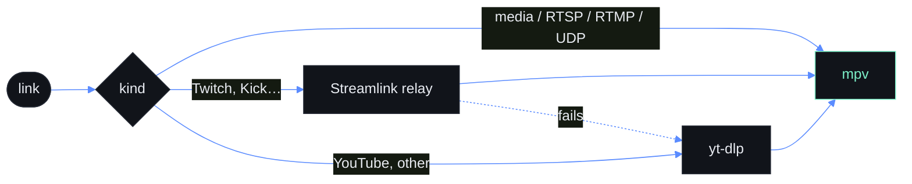
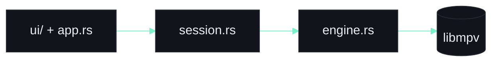

<div align="center">


# Lumen

**Every format. Every frame.**

A native media player for Linux, in one Rust binary on libmpv. egui for the interface,
video drawn directly on Wayland. No Qt, Python or libVLC runtime.


</div>

> [!IMPORTANT]
> An early release: playback and streams are covered, and the rest is listed in [docs/migration.md](docs/migration.md). No performance claims are made.

```text
╔═╗ FEATURES
```

| | |
| --- | --- |
| **Playback** | Local files and URLs via libmpv, hardware decoding when available |
| **Queue** | Shuffle, repeat, M3U, drag and drop, next-file-in-folder (`ep2` → `ep10`) |
| **Memory** | Resume, per-file tracks, sync, bookmarks |
| **Controls** | Frame step, chapters, A-B loop, 0.25×–4× speed, volume to 200% |
| **Tracks** | Audio and subtitle switching, delay in 50 ms steps |
| **Interface** | Sidebar queue, seek bar with hover time and chapters, mini player, always on top where allowed |
| **Streams** | Twitch, Kick and more via Streamlink; YouTube and others via yt-dlp |
| **SponsorBlock** | Skips sponsors, self-promo and reminders (intros and outros optional) |
| **Keys** | Every shortcut rebindable, conflicts refused |
| **Profile** | Own config in `~/.config/lumen-rs` |

**Not yet:** online subtitle search, equalizer and picture controls, seek-bar preview frames, media keys and MPRIS, packaging. [`docs/migration.md`](docs/migration.md) tracks each item.

```text
╔═╗ BUILD
```

## Build and run

Linux is the current target. Install a stable Rust toolchain, a C linker, the usual
X11/Wayland and OpenGL runtime libraries, and mpv's library.

```sh
sudo pacman -S mpv            # Arch; Debian and Ubuntu: libmpv-dev
cargo run --release -- movie.mkv
```

Streams need two optional programs on the `PATH`. Without them Lumen still plays files and
direct links, but a Twitch or YouTube page will not open.

```sh
sudo pacman -S streamlink yt-dlp
```

The tests also need `ffmpeg` on the `PATH`; they generate their own media and are
skipped when it is missing. The Streamlink relay test is skipped without `streamlink`,
and tests against real Twitch and YouTube run only with `LUMEN_NETWORK_TESTS=1`.

```sh
cargo test
LUMEN_NETWORK_TESTS=1 cargo test --test streams   # optional, needs internet
```

```text
╔═╗ KEYS
```

## Keys

| Key | Action | Key | Action |
| --- | --- | --- | --- |
| Space | Play / pause | `[` `]` `=` | Slower / faster / normal speed |
| ← → | Seek 10 s | ↑ ↓ | Volume |
| Shift+← → | Seek 1 min | M | Mute |
| Home | Restart file | J K | Audio delay −/+ 50 ms |
| N P | Next / previous | G H | Subtitle delay −/+ 50 ms |
| `.` `,` | Next / previous frame | B V | Cycle audio / subtitle track |
| PgDn PgUp | Next / previous chapter | L | A-B loop: set A, set B, clear |
| S | Stop | Ctrl+B | Bookmark |
| F, Esc | Fullscreen, leave | Ctrl+Shift+S | Screenshot |
| Q | Show / hide queue | Delete | Remove queue item |
| Ctrl+L | Open network stream | Ctrl+O | Open media |
| Ctrl+M | Mini player | Ctrl+T | Always on top |
| Ctrl+, | Preferences | | |

To rebind a key, open **… → Keyboard shortcuts** (or Preferences, Ctrl+,), click a shortcut and
press the new keys. Escape cancels, and a key another action uses is refused. The choices are
stored under `keys` in `~/.config/lumen-rs/settings.json`.

```text
╔═╗ STREAMS
```

## Streams and privacy

> [!NOTE]
> Lumen goes online only when you ask it to.

It connects to play a link, or for SponsorBlock on a YouTube video. Which program handles a link:



- Plain media and playlist links (`.mp4`, `.m3u8`, …), RTSP, RTMP and UDP go straight to mpv.
- A link Streamlink has a site plugin for, such as Twitch or Kick, plays through Streamlink.
  If Streamlink fails for any reason except "no playable streams" (an offline channel), Lumen
  tries yt-dlp.
- Anything else, and all YouTube links, is resolved by yt-dlp, and played directly if yt-dlp
  cannot read it.

SponsorBlock lookups send only a four-character prefix of a hash of the video id, so the
service does not learn which video is playing. Segment data belongs to the SponsorBlock
contributors (CC BY-NC-SA 4.0).

Settings in `settings.json`: `stream_quality` (`"best"`, or a name such as `"720p60"`),
`low_latency` (Twitch and Kick), `sponsorblock`, and `sponsorblock_intros`.

## The demo

[`docs/demo.gif`](docs/demo.gif) is recorded from the real player, not mocked up. [`scripts/record-demo.sh`](scripts/record-demo.sh) makes
a few silent clips (generated pictures with no audio stream), plays a scripted tour in a real
window with injected mouse and key input, and encodes the frames (with gifski when it is installed, else ffmpeg). It needs ffmpeg and a desktop
session, and the player runs muted. On a virtual display with software GL, set `DEMO_GRAB=1` so the
screen itself is recorded. Rerun it after changing the interface.

```text
╔═╗ PROJECT
```

## Project layout



Playback policy lives in `session.rs`, mpv calls in `engine.rs`, and the window in `app.rs`. Details in [`docs/architecture.md`](docs/architecture.md); what is and is not tested in [`docs/verification.md`](docs/verification.md). Contributing: [`CONTRIBUTING.md`](CONTRIBUTING.md). History: [`CHANGELOG.md`](CHANGELOG.md).

## License

MIT. Playback uses mpv through its dynamic library; see [`THIRD_PARTY_NOTICES.md`](THIRD_PARTY_NOTICES.md).
