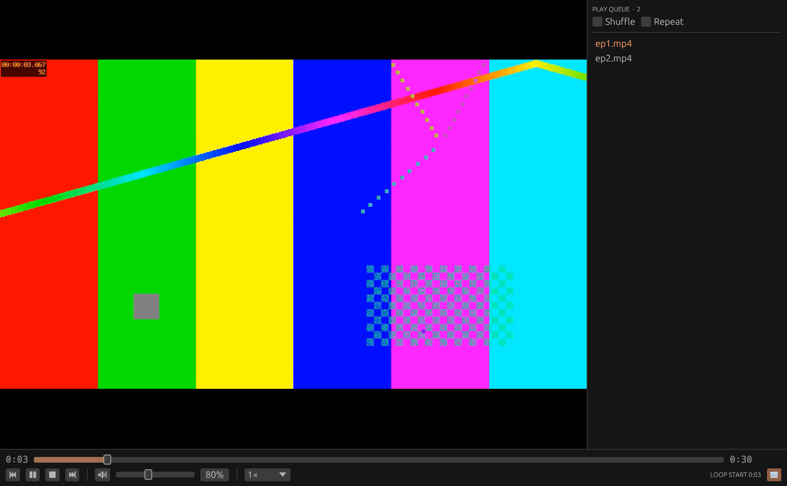

<h1 align="center">Lumen · Rust</h1>
<p align="center"><strong>Every format. Every frame. In a better light.</strong><br>A native media player, built in Rust on libmpv.</p>

<p align="center"></p>

**An early, working native rewrite of [Lumen](https://github.com/DakodaStemen/lumen).**
This repository is independent of the Python version. It uses egui/eframe for the
interface and libmpv for playback, so video is drawn natively on Wayland instead of
through XWayland. There is no Qt, Python or libVLC in this application.

The existing Lumen release remains the reference application. This preview covers
the playback core only and is not yet a feature-complete replacement. No performance
superiority is claimed.

## Working today

- Playback of local files and URLs through libmpv, with hardware decoding when available.
- Play queue with shuffle, repeat, M3U import, drag and drop, and automatic
  continuation with the next file in the folder (`ep2` is followed by `ep10`).
- Resume where you left off, plus per-file memory of audio track, subtitle track,
  audio and subtitle sync, and bookmarks.
- Seek bar, frame stepping in both directions, chapters, A-B loop, speed from 0.25× to 4×,
  and volume up to 200%.
- Audio and subtitle track switching, and audio and subtitle delay in 50 ms steps.
- Screenshots, fullscreen with auto-hiding controls, and a status line.
- A key for every action, each rebindable in the settings file.
- Its own profile in `~/.config/lumen-rs`; the Python version's settings are never read or changed.

## Not yet

Live streams (Streamlink), YouTube and other sites (yt-dlp), SponsorBlock, online
subtitle search, the equalizer and picture controls, seek-bar previews, the mini
player, media keys and MPRIS, and packaging. `docs/migration.md` tracks each item.

## Build and run

Linux is the current target. Install a stable Rust toolchain, a C linker, the usual
X11/Wayland and OpenGL runtime libraries, and mpv's library.

```sh
sudo pacman -S mpv            # Arch; Debian and Ubuntu: libmpv-dev
cargo run --release -- movie.mkv
```

The tests also need `ffmpeg` on the `PATH`; they generate their own media and are
skipped when it is missing.

```sh
cargo test
```

## Keys

| Key | Action | Key | Action |
| --- | --- | --- | --- |
| Space | Play / pause | `[` `]` `=` | Slower / faster / normal speed |
| ← → | Seek 10 s | ↑ ↓ | Volume |
| Shift+← → | Seek 1 min | M | Mute |
| Home | Restart file | J K | Audio delay −/+ 50 ms |
| N P | Next / previous | G H | Subtitle delay −/+ 50 ms |
| `.` `,` | Next / previous frame | B V | Cycle audio / subtitle track |
| PgDn PgUp | Next / previous chapter | L | A-B loop: set A, set B, clear |
| S | Stop | Ctrl+B | Bookmark |
| F, Esc | Fullscreen, leave | Ctrl+Shift+S | Screenshot |
| Q | Show / hide queue | Delete | Remove queue item |

To rebind, add an entry under `keys` in `~/.config/lumen-rs/settings.json`, such as
`"mute": "Ctrl+U"`. An empty string unbinds the action. The action names are listed in
`src/keys.rs`.

## Project layout

See `docs/architecture.md`. Playback policy lives in `session.rs`, mpv calls in
`engine.rs`, and the window in `app.rs`.

## License

MIT. Playback uses mpv through its dynamic library; see `THIRD_PARTY_NOTICES.md`.
