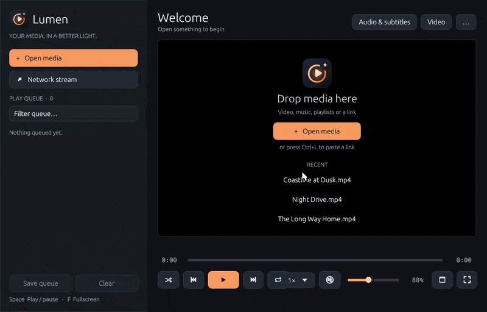

<h1 align="center">Lumen · Rust</h1>
<p align="center"><strong>Every format. Every frame. In a better light.</strong><br>A native media player, built in Rust on libmpv.</p>

<p align="center"></p>

**An early, working native rewrite of [Lumen](https://github.com/DakodaStemen/lumen).**
This repository is independent of the Python version. It uses egui/eframe for the
interface and libmpv for playback, so video is drawn natively on Wayland instead of
through XWayland. There is no Qt, Python or libVLC in this application.

The existing Lumen release remains the reference application. This preview covers
playback and streams, and is not yet a feature-complete replacement. No performance
superiority is claimed.

## Working today

- Playback of local files and URLs through libmpv, with hardware decoding when available.
- Play queue with shuffle, repeat, M3U import, drag and drop, and automatic
  continuation with the next file in the folder (`ep2` is followed by `ep10`).
- Resume where you left off, plus per-file memory of audio track, subtitle track,
  audio and subtitle sync, and bookmarks.
- Seek bar, frame stepping in both directions, chapters, A-B loop, speed from 0.25× to 4×,
  and volume up to 200%.
- Audio and subtitle track switching, and audio and subtitle delay in 50 ms steps.
- Screenshots, fullscreen with auto-hiding controls, and a status line.
- Lumen's own layout: a sidebar with **Open media**, **Network stream** and a filterable queue
  (right-click for play, copy location and remove; **Save queue** writes an M3U), a "Now playing"
  header with **Audio & subtitles**, **Video** and **…** menus, and a welcome screen with your
  recent files. The same menus open on right-click over the picture.
- A seek bar with a time (and chapter name) under the pointer, chapter ticks and the A-B loop
  shown on it; click the picture to pause, double-click for fullscreen, scroll for volume.
- Native file pickers for media and subtitle files, drag and drop with a drop hint, and
  spinners while a link is being opened.
- A mini player, and always on top where the desktop allows it.
- Preferences with every setting and a keyboard tab to rebind any key, with conflicts refused.
- Media information, chapters, bookmarks and recent files in the menus.
- Live streams from Twitch, Kick and other sites through [Streamlink](https://streamlink.github.io),
  run as a private relay on 127.0.0.1 so Streamlink's own ad handling applies, with a quality
  picker and the stream's title.
- YouTube and other video sites through [yt-dlp](https://github.com/yt-dlp/yt-dlp), including
  sites that serve video and audio separately.
- [SponsorBlock](https://sponsor.ajay.app): sponsor reads, self-promotion and subscribe
  reminders in YouTube videos are skipped (intros and outros optionally).
- An "Open network stream" dialog (Ctrl+L) for HTTP, HTTPS, RTSP, RTMP, UDP and RTP links.
- Its own profile in `~/.config/lumen-rs`; the Python version's settings are never read or changed.

## Not yet

Online subtitle search, the equalizer and picture controls, seek-bar preview frames, media
keys and MPRIS, and packaging. `docs/migration.md` tracks each item.

## Build and run

Linux is the current target. Install a stable Rust toolchain, a C linker, the usual
X11/Wayland and OpenGL runtime libraries, and mpv's library.

```sh
sudo pacman -S mpv            # Arch; Debian and Ubuntu: libmpv-dev
cargo run --release -- movie.mkv
```

Streams need two optional programs on the `PATH`. Without them Lumen still plays files and
direct links, but a Twitch or YouTube page will not open.

```sh
sudo pacman -S streamlink yt-dlp
```

The tests also need `ffmpeg` on the `PATH`; they generate their own media and are
skipped when it is missing. The Streamlink relay test is skipped without `streamlink`,
and tests against real Twitch and YouTube run only with `LUMEN_NETWORK_TESTS=1`.

```sh
cargo test
LUMEN_NETWORK_TESTS=1 cargo test --test streams   # optional, needs internet
```

## Keys

| Key | Action | Key | Action |
| --- | --- | --- | --- |
| Space | Play / pause | `[` `]` `=` | Slower / faster / normal speed |
| ← → | Seek 10 s | ↑ ↓ | Volume |
| Shift+← → | Seek 1 min | M | Mute |
| Home | Restart file | J K | Audio delay −/+ 50 ms |
| N P | Next / previous | G H | Subtitle delay −/+ 50 ms |
| `.` `,` | Next / previous frame | B V | Cycle audio / subtitle track |
| PgDn PgUp | Next / previous chapter | L | A-B loop: set A, set B, clear |
| S | Stop | Ctrl+B | Bookmark |
| F, Esc | Fullscreen, leave | Ctrl+Shift+S | Screenshot |
| Q | Show / hide queue | Delete | Remove queue item |
| Ctrl+L | Open network stream | Ctrl+O | Open media |
| Ctrl+M | Mini player | Ctrl+T | Always on top |
| Ctrl+, | Preferences | | |

To rebind a key, open **… → Keyboard shortcuts** (or Preferences, Ctrl+,), click a shortcut and
press the new keys. Escape cancels, and a key another action uses is refused. The choices are
stored under `keys` in `~/.config/lumen-rs/settings.json`.

## Streams and privacy

Lumen goes online only when you ask it to: to play a link, or for SponsorBlock on a
YouTube video. Which program handles a link:

- Plain media and playlist links (`.mp4`, `.m3u8`, …), RTSP, RTMP and UDP go straight to mpv.
- A link Streamlink has a site plugin for, such as Twitch or Kick, plays through Streamlink.
  If Streamlink fails for any reason except "no playable streams" (an offline channel), Lumen
  tries yt-dlp.
- Anything else, and all YouTube links, is resolved by yt-dlp, and played directly if yt-dlp
  cannot read it.

SponsorBlock lookups send only a four-character prefix of a hash of the video id, so the
service does not learn which video is playing. Segment data belongs to the SponsorBlock
contributors (CC BY-NC-SA 4.0).

Settings in `settings.json`: `stream_quality` (`"best"`, or a name such as `"720p60"`),
`low_latency` (Twitch and Kick), `sponsorblock`, and `sponsorblock_intros`.

## The demo

`docs/demo.gif` is recorded from the real player, not mocked up. `scripts/record-demo.sh` makes
a few silent clips (generated pictures with no audio stream), plays a scripted tour in a real
window with injected mouse and key input, and encodes the frames. It needs ffmpeg and a desktop
session, and the player runs muted. Rerun it after changing the interface.

## Project layout

See `docs/architecture.md`. Playback policy lives in `session.rs`, mpv calls in
`engine.rs`, and the window in `app.rs`.

## License

MIT. Playback uses mpv through its dynamic library; see `THIRD_PARTY_NOTICES.md`.
