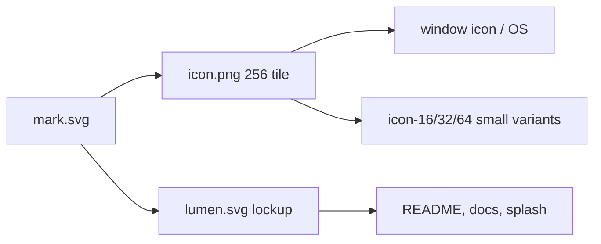

# Lumen brand

## Concept
One symbol: a **play triangle inside a lens ring**. The ring is open on the right, where the light exits, and doubles as a "C" for Lumen. A thin aperture blade splits the triangle horizontally. Light, lens and play in a single geometric shape. Dark-first, quiet, no text in the mark.

The wordmark is monoline, geometric, lowercase-body "Lumen", drawn as stroked paths (no font dependency).

## Files
| File | Use |
|---|---|
| `assets/lumen.svg` | Lockup: mark + wordmark (light text, for dark backgrounds) |
| `assets/mark.svg`, `mark.png` | Mark only, transparent, 512px |
| `assets/icon.png` | 256px app icon (embedded by `src/main.rs`, `examples/demo.rs`) |
| `assets/icon-16/32/64.png` | Small-size checks. 16 and 32 drop the ring and enlarge the triangle for legibility |
| `assets/contact-sheet.png` | Icon at 16/32/64/256 on dark and light |

## Palette
| Role | Hex |
|---|---|
| Background | `#0A0C10` |
| Panel | `#11141A` |
| Raised | `#181C24` |
| Border | `#232833` |
| Text | `#E9ECF2` |
| Muted | `#8A93A6` |
| Accent mint | `#7CF0C8` |
| Accent blue | `#5B8CFF` |
| Warn | `#FFB454` |

Mark gradient: mint `#7CF0C8` to blue `#5B8CFF`, top-left to bottom-right.

## Clear space and size
- Clear space: at least the width of the triangle's blade gap x 6, or 25% of the mark's width, on all sides.
- Minimum size: mark 16px (use the ring-less small variant below 48px); lockup 96px wide.
- App icon corner radius: 22.4% of the side.

## Do / Don't
| Do | Don't |
|---|---|
| Use the mint-blue gradient on dark | Recolour the gradient or add warn orange to the mark |
| Use the ring-less variant at 16/32px | Shrink the full ring mark below 48px |
| Keep the blade gap transparent | Fill the gap with a solid colour |
| Place on `#0A0C10`-`#181C24` | Place on busy photos or light backgrounds without the tile |
| Keep the ring opening on the right | Rotate, outline, shadow or stretch the mark |

## Usage

